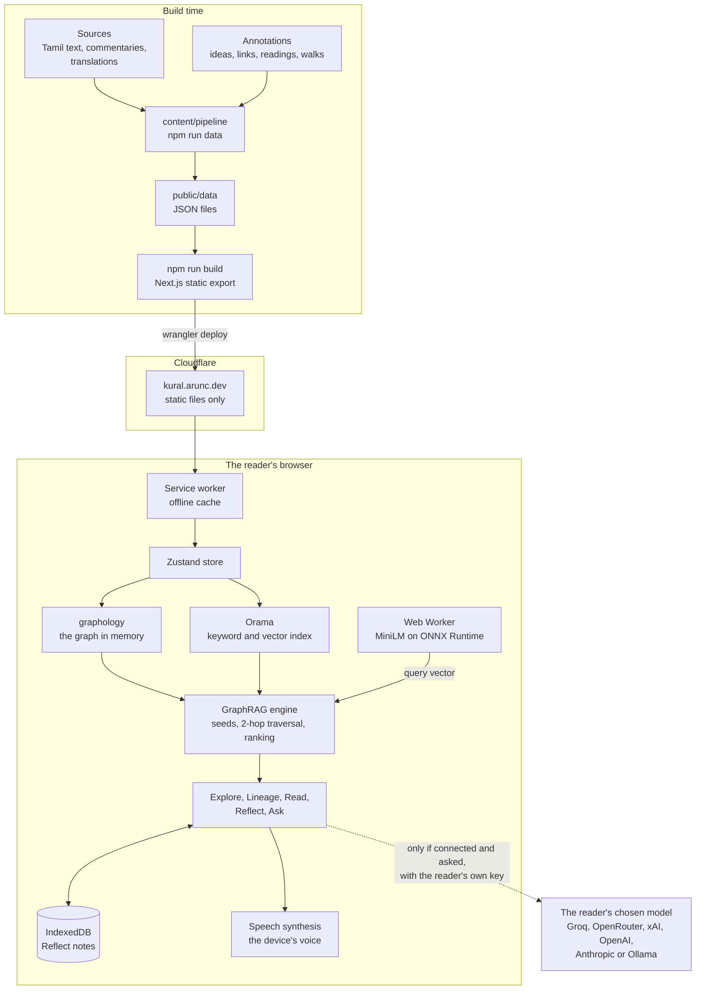
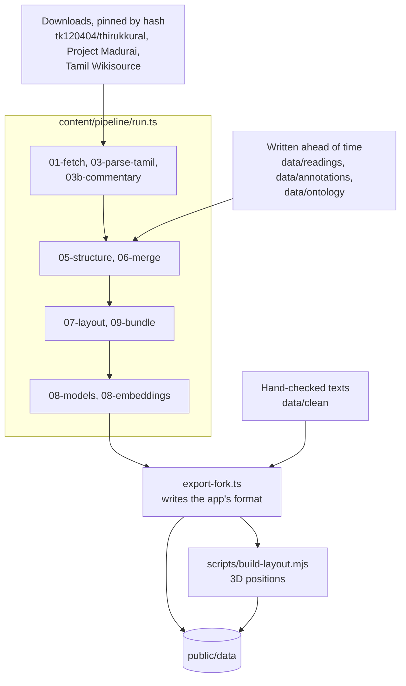
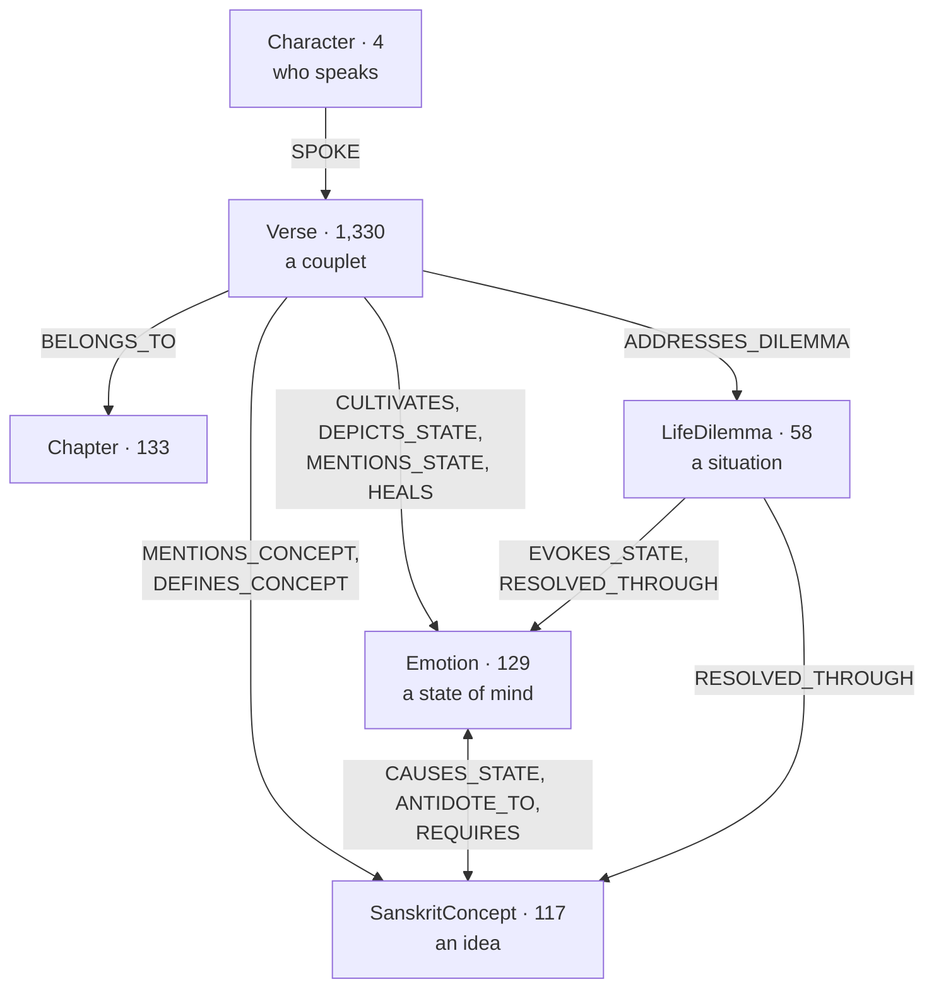
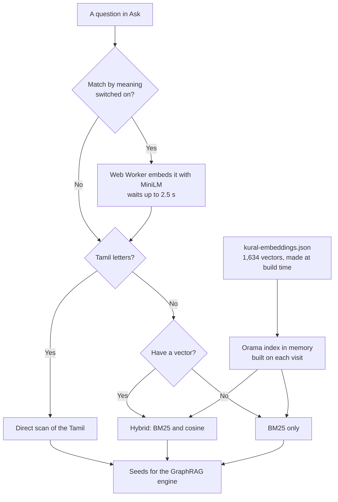
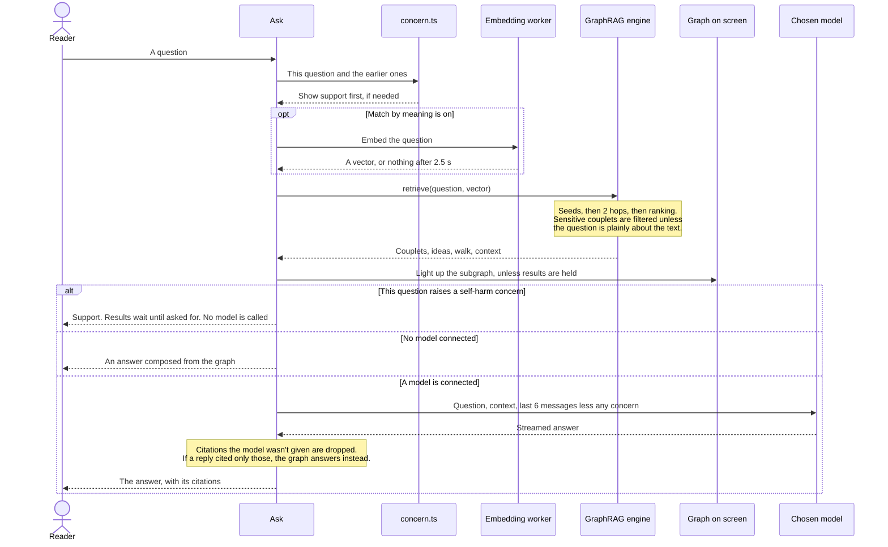

# Architecture

Kural Graph is a static site. There is no server of ours, no database and no vector store. Every file is built ahead of time and served as it is, and all the logic, search included, runs in the reader's browser. After a first visit, the only thing that needs a network is a language model, and only if a reader connects one.

It is a fork of [GitaViśva](https://github.com/HimanshuMohanty-Git24/gitaviswa), and the design is GitaViśva's. [Differences from upstream](#differences-from-upstream) lists what changed, and [UPSTREAM.md](UPSTREAM.md) explains how updates are merged.

The counts below are from the current data. `stats` in `public/data/kural-graph.json` always has the latest.

## The system

| Part | Built with |
|---|---|
| App | Next.js 15 static export, React 19, Tailwind 4, Zustand |
| Explore | `react-force-graph-3d`, `three`, positions computed ahead of time |
| Lineage | `@xyflow/react`, `dagre` |
| Graph | `graphology`, with its traversal, shortest path and Louvain packages |
| Search | Orama, in memory |
| Embeddings | `all-MiniLM-L6-v2` on ONNX Runtime Web |
| Notes | IndexedDB through `idb-keyval` |
| Hosting | Cloudflare static assets |

Code keeps GitaViśva's names so that merges stay simple, so some don't match what readers see:

| In the code | Means |
|---|---|
| `Verse`, `verse` | A couplet |
| `SanskritConcept` | An idea |
| `Emotion` | A state of mind |
| `LifeDilemma` | A situation |
| `sanskrit`, `"sa"`, `hasDevanagari` | The Tamil text, Tamil, a test for Tamil letters |
| `adhyayana`, `manas` | The Read and Reflect views |

## Differences from upstream

| | GitaViśva | Kural Graph |
|---|---|---|
| Hosting | Next.js with route handlers on Vercel | Static files on Cloudflare. `src/app/api` is deleted |
| Model calls | Through `/api/chat` | Straight from the browser to the provider |
| Query embedding | `/api/embed`, on the server | A Web Worker, in the browser |
| Keys | `localStorage` and `.env.local` | The browser only, for this tab unless the reader says otherwise |
| Graph database | Optional sync to Neo4j | None |
| Data build | `scripts/` | `content/pipeline/` |
| Recitation | Streamed from other sites | The project's own recordings, then the device's voice |
| Map | Galaxy | Galaxy or lotus |
| Situations | Routed to the graph | Also walks, from a situation through feelings to couplets |

Kural logic lives in `src/kural/`. GitaViśva's data scripts are still in `scripts/`, unused, because deleting them would only cause conflicts: `build-gita-knowledge-graph.mjs`, `build-commentary-extras.mjs`, `build-embeddings.mjs`, `prefetch-sources.mjs`, `fetch-vedicscriptures.mjs` and `ontology/`. So are the diagrams in `docs/diagrams/`, which describe the Gita site, not this one.

## The content pipeline

`npm run data` rebuilds `public/data/` byte for byte. Nothing in it writes prose: the readings and annotations were written ahead of time, and an AI wrote them, as the README says. The pipeline checks them, merges them and refuses to finish if a check fails. The only model it runs is MiniLM, to make the vectors.

| File | Size | Holds | Loaded |
|---|---|---|---|
| `kural-verses.json` | 2.8 MB | The couplets, every translation, chapters and authors | At the start |
| `kural-graph.json` | 1.8 MB | Nodes, edges, chains and threads | At the start |
| `kural-embeddings.json` | 855 KB | The vectors | Once the browser is idle |
| `kural-layout.json` | 106 KB | Positions for the 3D map | When the map opens |
| `commentary/K_n.json` | 1,330 files | The commentaries on one couplet | When a couplet is opened |
| `commentary-all.json` | 7.6 MB | All of them, written by `finish-export.mjs` | By the service worker, to keep offline |

`content/.cache/` holds fields that must never ship. See [content/README.md](content/README.md).

## The knowledge graph

1,771 nodes and 6,862 edges.

Links inside one type aren't drawn. This table has them all.

| Relation | From | To | Count |
|---|---|---|---:|
| `BELONGS_TO` | Couplet | Chapter | 1,330 |
| `SPOKE` | Character | Couplet | 1,330 |
| `NEXT_VERSE` | Couplet | Couplet | 1,329 |
| `MENTIONS_CONCEPT` | Couplet | Idea | 810 |
| `CULTIVATES` | Couplet | State | 545 |
| `DEPICTS_STATE` | Couplet | State, idea | 484 |
| `ADDRESSES_DILEMMA` | Couplet | Situation | 150 |
| `NEXT_CHAPTER` | Chapter | Chapter | 133 |
| `DEFINES_CONCEPT` | Couplet | Idea, state | 116 |
| `RESOLVED_THROUGH` | Situation | State, idea | 103 |
| `EVOKES_STATE` | Situation | State | 101 |
| `ECHOES_VERSE` | Couplet | Couplet | 77 |
| `MENTIONS_STATE` | Couplet | State | 67 |
| `IN_TENSION_WITH` | Couplet | Couplet | 63 |
| `HEALS` | Couplet | State | 58 |
| `CAUSES_STATE` | State, idea | State, idea | 51 |
| `ANTIDOTE_TO` | State, idea | State, idea | 47 |
| `REQUIRES` | State, idea | State, idea | 34 |
| `QUALIFIES` | Couplet | Couplet | 24 |
| `OPPOSES` | State | State | 10 |

The file also holds 12 chains and 16 threads, and marks 161 couplets `sensitive`. Its `dialogues` list is empty, because that was a Gita idea.

There is no graph database. `src/lib/graph/graphStore.ts` loads the file into two graphs in memory: a `MultiDirectedGraph` with every relation, and a weighted `UndirectedGraph` used for traversal and shortest paths. A reader's own notes join them as `PersonalThought` nodes while the page is open. They are walls: they never shape retrieval, and their text can't reach a model's context through it.

## Search and embeddings

**There is no vector database.** The vectors are one static JSON file, loaded into an Orama index in the browser's memory. At 1,634 vectors, an exact scan costs about 627,000 multiplications per query, so there is nothing for a vector database or an approximate index to speed up, and leaving them out keeps the site static and offline.

| | |
|---|---|
| Model | `Xenova/all-MiniLM-L6-v2`, the quantised ONNX file, pinned to one revision and checked against `content/pipeline/models.lock.json` |
| Runtime | ONNX Runtime Web (WASM) on one thread. The build and the browser use the same runtime and model, so stored vectors and a query embedded on a phone share one space |
| What has a vector | 1,330 couplets, from the plain reading, gloss and keywords, and 304 ideas, states and situations, from the label, definition and synonyms |
| Format | 384 dimensions, unit length, stored as int8 and base64: 613 KB of vectors in an 855 KB file |
| Index | Orama, rebuilt in memory on each visit: 1,771 documents, of which 1,634 have a vector |
| Similarity | Cosine, as an exact linear scan with a floor of 0.25 |
| Ranking | Hybrid of BM25 and cosine, weighted 0.45 and 0.55 |
| Cost to a reader | A one-time download of about 38 MB (model 23 MB, runtime 15 MB, tokenizer 0.7 MB), hosted with the site and kept for offline use |

**Vectors are opt-in, and only Ask uses them.** "Match by meaning as well as words" in Settings is off by default, so that nobody downloads 38 MB without choosing to.

| Search | Keywords | Vectors |
|---|---|---|
| Ctrl K | Yes | No |
| Reflect | Yes | No |
| Ask, by default | Yes | No |
| Ask, with the setting on | Yes | Yes |
| Anything typed in Tamil letters | Direct scan | No |

Known limits:

- The 855 KB file is fetched and indexed for every reader, though most never use it, because the index is built with vectors whether or not the setting is on.
- MiniLM reads English only, so Tamil can't be embedded. Tamil queries use the direct scan instead.
- The first question after switching the setting on usually falls back to keywords: the model takes longer than 2.5 seconds to arrive, and goes on loading for the next question.

## Ask

1. **Seeds.** `router.ts` and `src/kural/route.ts` map everyday words onto situations, states and ideas. Couplet and chapter references are read directly, and Orama adds its hits.
2. **Traversal.** A breadth-first walk of two hops from each seed. Hubs of more than 60 links are reached but not expanded, and scores fall with depth and degree.
3. **Ranking.** The top couplets, ideas, states and situations, with any chains and tensions that touch them. A situation brings its walk, whose couplets come first.
4. **Answer.** `src/kural/compose.ts` writes the answer with no model. With one, `buildContext` in `engine.ts` writes the context it reads.

## Safety

| Rule | Where it is enforced |
|---|---|
| Support comes before any couplet | `src/kural/concern.ts`, `src/kural/Support.tsx` |
| When a question raises a self-harm concern, Ask holds its results until the reader asks for them, lights nothing on the map and calls no model for it | `src/lib/graphrag/engine.ts`, `GraphRagChatbot.tsx` |
| Those words, and the reply to them, never go out as history with a later question | `withoutConcerns` in `src/kural/concern.ts` |
| A note that raises a self-harm concern can't be sent from Reflect, even when the reader shows the couplets anyway | `deepen` in `PersonalMindMapper.tsx` |
| Sensitive couplets stay off walks and Reflect, and off Ask unless a question is plainly about the text | `safeFor` in `src/kural/walk.ts`, `offerable` in `engine.ts` |
| A sensitive couplet can't be cited without its note | `src/lib/graphrag/citations.ts` |
| Invented citations are dropped | `keepSupplied` in `citations.ts` |
| A reader's notes never shape public retrieval | `retrieve` in `engine.ts` |
| A path through a reader's note is shown on the device and never sent to a model | `SutraPathFinder.tsx` |

A later question in the same conversation still goes to the model, with the support kept on screen. Only the words that raised the concern stay behind.

## Models and keys

Readers bring their own key. The browser calls the provider directly, and the Content-Security-Policy in `public/_headers` allows connections only to the listed providers and to a local Ollama. Nothing goes to a model unless one is connected and the reader asks.

| Mode | Started from | What is sent |
|---|---|---|
| `chat` | Ask | The question, the context and the last 6 messages, less anything that raised a self-harm concern |
| `analyze` | "Explore with AI" in Reflect | The note, and lists of ideas and couplets to choose from |
| `bridge` | The path finder on the map | The path to explain, if it doesn't run through a reader's note |
| `translate` | The Language picker on a couplet | The couplet and its English |
| `commentary` | The Commentaries tab | A Tamil commentary, to translate |

## Where things are kept

| What | Where | Leaves the device? |
|---|---|---|
| Reflect notes and drafts | IndexedDB | Only a note the reader sends with "Explore with AI", and never one that raises a self-harm concern |
| AI translations | IndexedDB | No |
| Conversation in Ask | Memory, gone on reload | Sent to the model, if one is connected, less anything that raised a self-harm concern |
| Provider keys | `sessionStorage`, or `localStorage` if the reader asks | Only to that provider |
| Settings and reading preferences | `localStorage` | No |
| Site files, data and commentaries | Cache Storage, named for the build | No |
| The embedding model | Cache Storage, `kural-graph-models` | No |

There are no analytics and no third-party requests. Cloudflare injects its analytics script into HTML on this zone unless told not to, so `public/_headers` sets `no-transform` on every HTML route. A new route needs that rule too.

## Offline

`public/sw.js` keeps the site working with no network.

- On install it keeps the shell, and unpacks `commentary-all.json` into all 1,330 commentaries. One file avoids 1,330 requests, any one of which could fail the install.
- Build files, data and images are served from the cache first. Pages go to the network first.
- `/models/`, `.wasm` files and `/audio/` are left alone. The embedding worker keeps its own large files, in a cache that outlives new versions of the site. Players ask for byte ranges, which a cache can't store.
- `finish-export.mjs` fills in the list of files and a version made from their contents, so any change makes a new worker.

## Listening

`src/lib/store/audioStore.ts` plays `/audio/0380.mp3` for Kural 380, if the recording exists, and otherwise hands over to the device's voice. A device with no Tamil voice reads the plain reading in English instead, and says so. Chapter recordings play when they exist.

"After each couplet, read the translation" reads whatever the page's Translation picker has chosen. Translators' words come from `kural-verses.json` and need no network. parimēlaḻagar's English comes from the commentary entry, which on 330 couplets adds a setting or a note to what the page shows. See [public/audio/README.md](public/audio/README.md).

Pausing never calls `speechSynthesis.pause()`, because on Android that ends the utterance and leaves `resume()` nothing to resume. So pausing stops the voice and keeps the place, and resuming starts that passage again: a couplet, or one part of a reading, which is at most 220 characters.

The device's voice belongs to the operating system, not the browser, and English prefers US, then British, then any other. So the same browser can speak on one machine and not another:

- **Linux:** Chromium browsers, Brave included, have no voices unless `speech-dispatcher` is installed and the browser starts with `--enable-speech-dispatcher`. Its default engine, eSpeak NG, sounds robotic.
- **Brave:** at the strictest fingerprinting setting, Shields hides every voice on any system. At the standard setting it adds one fake voice, which `pickVoice` doesn't reach because the real ones come first.

With no voice and no recording, the player says so. Only recordings reach every reader.

With Follow along on, Read moves to the chapter the audio has reached. It stays put if the reader has gone to another chapter, and picks up again when they come back.

## Build and deploy

`npm run deploy` runs these in order:

1. `prebuild` fetches the model into `public/models/` and checks its hash. It is too big to keep in git.
2. `next build` writes the static site to `out/`.
3. `scripts/finish-export.mjs` moves Next's inline scripts into a file, because the policy in `public/_headers` blocks inline scripts. It then fills in the service worker and checks the result against Cloudflare's limits of 25 MB a file and 20,000 files.
4. `wrangler deploy` publishes `out/` as the worker `kural`, on `kural.arunc.dev`.

Always build with `npm run build`, never `next build` alone, or the site won't run under its own policy.

## Where to find things

| Path | Holds |
|---|---|
| `content/` | Sources, annotations and the pipeline |
| `public/data/` | Generated data. Never edit by hand |
| `src/kural/` | Kural logic: walks, safety rules, the composed answer, the embedder, the graph's shapes |
| `src/lib/graphrag/` | Search, retrieval, routing, citations, prompts |
| `src/lib/graph/` | The in-memory graphs, relations and path finding |
| `src/lib/llm/` | Providers and streaming from the browser |
| `src/lib/store/` | State: the graph, audio, settings and notes |
| `src/lib/commentary/` | Commentators, and preparing text for speech |
| `src/components/` | The views: `graph/`, `reader/`, `chat/`, `manas/`, `home/`, `settings/`, `layout/` |
| `scripts/` | `build-layout.mjs`, `finish-export.mjs`, `verify-graph.mjs` and the home page art |
| `tests/` | `npm test`, including every walk and sensitive-couplet rule |
